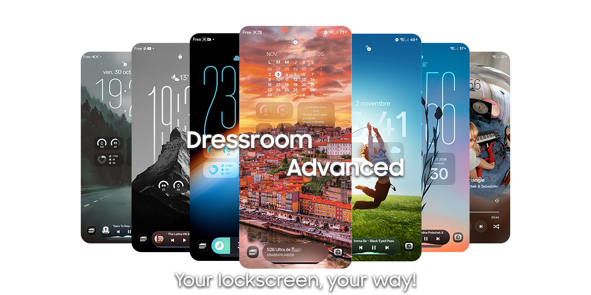

# Dressroom Advanced

An LSPosed API 102 module for Samsung's lockscreen editor. Adds clock, widget and Now Bar settings directly inside Dressroom, with live previews.

## Features

- Manual clock stretching, font controls, size, position, shadows and blur.
- Hide the date without hiding the weather.
- Wallpaper depth using Samsung Object Capture, with automatic detection and crop/zoom tracking.
- Widget scaling, custom grids, free placement and separate depth controls.
- Portrait and landscape settings on supported large-screen layouts.
- Keep the charging Now Bar card visible and add a custom text card.
- Fullscreen media artwork on One UI 9 AOD, plus an experimental 8.5 port.

## Support

| One UI | Apps | Support |
| --- | --- | --- |
| 9.0 | AOD + Dressroom | Supported — tested on SM-S948B |
| 8.5 | Clock Style + Dressroom | Supported — tested on SM-P613 with a custom ROM |
| 9.0 | Clock Style + Dressroom | Unsupported |
| 8.5 | AOD + Dressroom | Experimental shim — not yet tested on an AOD device |
| 8.0 | Any combination | Unsupported |

Not every feature is available on both supported setups. The 8.5 fullscreen artwork port is experimental. Other devices and app versions may behave differently.

## Setup

1. Install the module and enable it in LSPosed.
2. Select Dressroom, SystemUI, and **AOD** or **Clock Style**, depending on your device.
3. Reboot and open the lockscreen editor.
4. Tap the clock for **Advanced**, or use the bottom-bar **Advanced** button for **Widgets** and **Extras**.
5. Tap Apply/Done to save your changes.

## Known issues

- Widgets disappear immediately when opening the media player; closing has a fade.
- The fullscreen song-change effect still needs some visual polish.
- Subject detection can miss fine details. Animated/video and gyro wallpapers are not supported for depth.
- Device-wide blur forcing is not included.

## License

You can use, study, modify and share the project for free. Keep credit to **BlueOutside / Dressroom Advanced**, share the source of distributed modifications, and don't sell or paywall the code, module or derivatives. Don't pass someone else's work off as your own.

See [LICENSE](LICENSE) for the full terms. Build instructions are in [Contributing](CONTRIBUTING.md).
