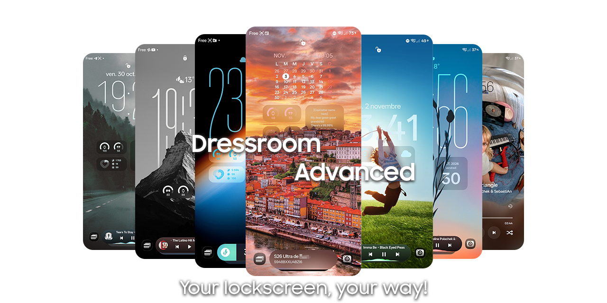
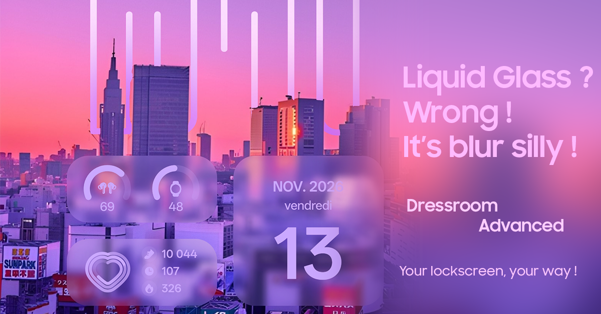

# Dressroom Advanced

An LSPosed (API 102) module that adds clock, widget and Now Bar controls to Samsung's lockscreen editor, with live previews inside Dressroom.
Give your lockscreen the renaissance it deserves!

## Features

- Clock size, position, manual stretching, shadows and blur.
- Separate blur radius, saturation and tint controls for the clock, widgets and Now Bar, where native blur is available.
- Keep live blur during swipe-to-unlock on One UI 9 (experimental).
- Import TTF, OTF and TTC fonts. Adjust the axes the font provides, including weight, width, optical size, italic and custom axes.
- Hide the date while keeping weather visible.
- Wallpaper depth with Samsung Object Capture, automatic subject detection and crop/zoom tracking.*
- Widget scaling, custom grids, free placement and independent depth controls.
- Separate portrait and landscape layouts on supported large screens.
- Independent clock, widget and Extras settings for cover and inner screens on supported One UI 9 foldables.
- Keep the charging Now Bar card visible, add a custom text card, and show up to eight cards in the stack.
- Fullscreen album artwork in the expanded media player, with adaptive clock contrast and blurred aura.

Imported fonts use their own variable axes. Samsung's dynamic per-digit stretching remains limited to its supported native fonts.

## Support

| One UI | Apps | Status |
| --- | --- | --- |
| 9.0 | AOD + Dressroom | Tested on SM-S948B |
| 9.0, foldable | AOD + Dressroom | Experimental; tested on SM-F971B, cover and inner screens |
| 9.0 | Clock Style + Dressroom | Supported for clock, fonts, depth, widgets and Now Bar stack (ClockPack 8.9.65.92); clock blur and foldable profiles require AOD |
| 8.5 | Clock Style + Dressroom | Tested on SM-P613 with a custom ROM |
| 8.5 | AOD + Dressroom | Experimental; widget issues remain on some app versions |
| 8.0 | AOD or Clock Style + Dressroom | Experimental clock and depth port. See [tested APKs](docs/compatibility/ONE_UI_8_0.md). |
| 7.0 | Any combination | Unsupported (Support coming after 8.0 support update) |

Requires Android 16 or 17 and an LSPosed-compatible framework with API 102 support. Features also depend on the installed Dressroom and clock-provider versions.

The One UI 9 foldable port has been tested with Dressroom 3.0.01.20 and AOD 8.9.57.1 on SM-F971B. Clock saving, depth and separate widget selections work on the tested cover and inner screens. Other foldable models and some media and animation cases still need testing. Z Flip cover screens are not supported.

See [foldable support](docs/compatibility/ONE_UI_9_FOLDABLES.md) and [device validation](docs/compatibility/FOLDABLE_PARITY.md) for details.

*Depth is NOT supported on A0X A1X A2X and Pre-Awesome Intelligence A3X series? (and equivalent M & F?) series phones (lacking libraries that I WILL NOT INTEGRATE, a custom rom from a higher end phone may work, or porting the libs and fixing them can too!)

## Setup

1. Install the module and enable it in LSPosed/Vector.
2. Enable its scopes for Dressroom, SystemUI, and your device's **AOD** or **Clock Style** app.
3. Reboot, then open the lockscreen editor.
4. Tap the clock for **Advanced**, or use the bottom-bar **Advanced** button for **Widgets** and **Extras**.
5. Tap Apply/Done to save. Closing without applying discards the editor draft.

Reboot after module updates too, so all scoped processes load the new version.

Opening the editor checks for a newer GitHub release. (Checks are cached for 15 minutes.) Enable **Pre-release updates** under **Advanced -> Extras -> Updates**, or install a `dev` build from the `dev` branch, to also check pre-release builds and choose between stable and pre-release updates when both are newer.

For depth tracking during full-screen AOD wallpaper animations, also enable the Samsung live wallpaper scope (`com.samsung.android.wallpaper.live`). If its renderer is not supported or scoped, depth keeps its saved mapping.

For a font file, open **Clock → Advanced → Layout → Typography → Choose font file**. The module keeps a private copy, so the lockscreen does not need access to your Downloads folder.

## Known issues

- Some editor panels still need spacing and layout fixes.
- Media transitions and the fullscreen song-change effect still need visual polish.
- Subject detection can miss fine details or fail to initialize on some devices, including reported MediaTek setups. Animated, video and gyro wallpapers are not supported for depth.
- Dressroom's main preview can differ from the actual editor and lockscreen.

Check the [release notes](https://github.com/BlueOutside/Dressroom-Advanced/releases) for issues affecting a particular version.

## About liquid glass

## Building and contributing

See [CONTRIBUTING.md](CONTRIBUTING.md) for build instructions and [docs/](docs/README.md) for the source layout and compatibility notes.

## Credits

- One UI 9 foldable support was contributed by [thatjoshguy67](https://github.com/thatjoshguy67) in [PR #3](https://github.com/BlueOutside/Dressroom-Advanced/pull/3).
- All of the testers on [Telegram](https://t.me/dressr0om) that helped shape 2.0.0 (and future releases) 

## License

You can use, study, modify and share the project for free. Keep credit to **BlueOutside / Dressroom Advanced**, share the source of distributed modifications, and do not sell or paywall the code, module or derivatives. Do not pass someone else's work off as your own.

See [LICENSE](LICENSE) for the full terms.
