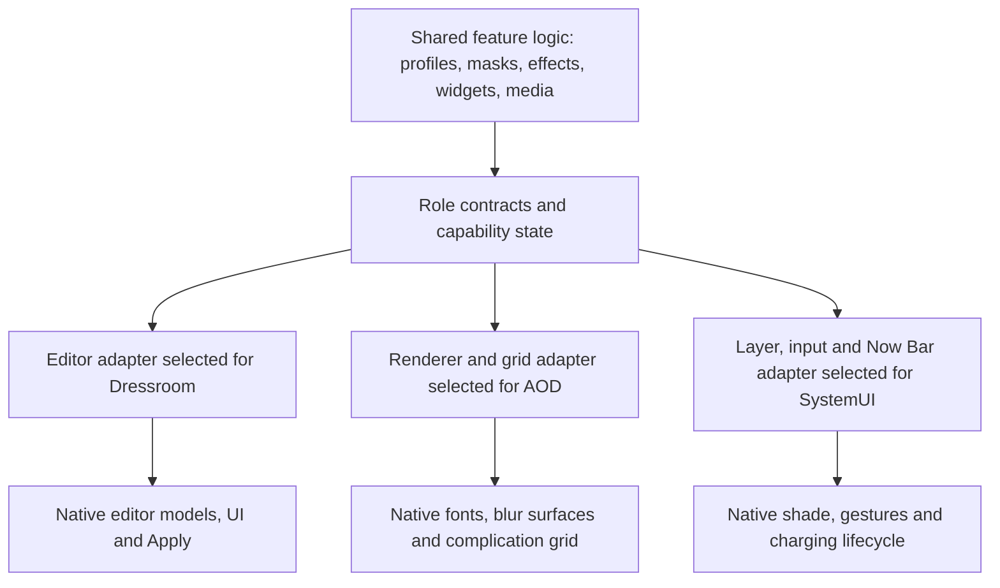

# Version adapters (shims)

This is the implementation design following the reference-code audit and the supplied 8.5 APK inspection. Editor ownership, native tabs/edit transactions and core clock rendering now have runtime bindings. The remaining role contracts below are still planned. See [implementation status](IMPLEMENTATION.md) for the exact boundary.

Keep one feature engine. A version adapter translates the native operations and data for a specific inspected package into that engine's contracts.

## Selection and ownership

- Select per package/artifact and actual class loader. One UI 8.5 is a useful release family, not a unique binding key. App updates can change one of the three packages without changing the other two.
- Keep the Android/framework blur contract separate: a SemBlurInfo private constructor is not part of the AOD APK's versioned code.
- Verify full method signatures, field types, interfaces and ownership before installing. A field name that exists with a different type is a hard mismatch.
- Resolve members once, then keep immutable typed binding objects. No class discovery, shape scanning or package-manager calls during drawing/animation frames.
- Keep Method/Class/Field objects local to the owning process/loader. Only primitive capability/profile data belongs in the module's IPC bridge.
- A feature can wait for a dynamically loaded provider. Distinguish WAITING from UNSUPPORTED; do not turn either into a per-frame retry loop.

Known inputs so far:

| Family | Dressroom | AOD | SystemUI |
| --- | --- | --- | --- |
| Working reference | 3.0.10.38 | 8.9.66.1 | Inspected reference SDK-37 build |
| Supplied 8.5 candidate | 2.9.60.51: editor roles mapped | 8.9.32.95: core/provider roles mapped | Older SDK-36 / interface-4006 input: legacy charging and plugin/input roles mapped |
| One UI 8.0 | No target APK mapped yet | No target APK mapped yet | No target APK mapped yet |

Neither the 8.5 candidate nor the 8.0 target is runtime-certified by this table. Record artifact SHA-256 and firmware/device identity before shipping an exact-binding allowlist.

The supplied SystemUI uses a different charging owner, SecPowerUI, from the reference ChargingAnimationUI. Keep those as separate NowBarBinding implementations rather than embedding owner guesses into common retention logic. See the [SystemUI inspection](SYSTEMUI_16_4006.md).

## Contracts

| Contract | Shared meaning; native details stay in the adapter |
| --- | --- |
| EditorBinding | Session, selected clock/model, native edit operation, prepare/freeze, verified Apply completion, cancel/failure |
| EditorUiBinding | Stock panel ownership, native tab insertion/index, SESL controls, toolbar rebuild and visibility/enabled lifecycle |
| ClockRendererBinding | Clock/font identity, actual render update, manual heights, native animation state and date/weather roles |
| ClockBlurBinding | Blur manager/strategy, path readiness, selected host coordinates, palette/opacity policy and native clear/update |
| WallpaperSourceBinding | Current full-image source identity, owned snapshot, crop/frame/source-to-window transform and readiness events |
| SubjectCaptureBinding | Worker-thread detection lifecycle; module-owned alpha plus source coordinates and explicit errors |
| WidgetBinding | Capacity versus scale, native orientation/reflow, spans, provider sizes, runtime root and separate surface ownership |
| MediaBinding | Artwork and native control roles, animated owner/progress, expand/collapse completion, close and title actions |
| NowBarBinding | Pill bounds versus unlock dispatch, charging timeout versus explicit/unplug dismissal, current charging visuals |

For example, common media return should ask ClockRendererBinding for the stored font, actual rendered-font update and native return animation. It should not know whether those are `T0/g0/K0` or `L0/b0/B0`.

Similarly, common SubjectCapture should receive alpha/coordinates and explicit errors. It should not depend on an SDK's synthetic Kotlin accessor layout. Semantically different outputs need translation, not an unchecked cast through a renamed method.

## Capability boundaries

Requested state and effective support are different. Keep saved settings even when a renderer or device cannot currently apply them.

- Editor controls require a known native save/cancel contract before accepting new module edits.
- Manual stretch requires font storage, normalization policy and rendered-height update. Keep-stretch additionally requires the correct native doze/media transition.
- Clock depth uses view/content clipping **and**, where present, native blur-surface clipping. Do not label the whole renderer supported when only one surface can be masked.
- Detection requires a supported SDK and a correct wallpaper source. Previously saved masks need their own validated source/display transform.
- Widget depth/blur and full-screen media need their actual native owners/layers. Missing media should not disable date/weather controls or widget positioning.
- Glyph caching is an optional optimization capability. Never make the core clock depend on a workaround for another build's cache.
- Fold/tablet/cover support is an additional display/geometry capability. A matching named class does not lift existing display exclusions.

Expose one concise unavailable/waiting reason in the editor and diagnostics. Do not reset preferences or silently show an enabled control for a feature with missing native bindings.

## Installation and migration

Preflight each feature's required members before touching it. Reserve INSTALLING to prevent class-load reentry, collect hook handles, then commit READY. Unhook on installation failure. Shared process-wide hooks need their own ownership/refcount policy so rolling back one provider adapter cannot remove another feature's hook.

Port the current working reference behind these contracts first and preserve its regression behavior. Then add the supplied 8.5 adapters. Do not build separate copies of all rendering logic for each One UI version.

Preserve saved native identities and profile records. Compare clock/font IDs, segment count/units and coordinate systems before importing data to another package build. Any translation must be explicit, preserve unknown data and avoid changing the user's committed choices just because the module updated.

Tests should include: missing/ambiguous members; fields with the same name and wrong type; failed partial installs; dynamic provider reentry; skipped/failed native saves; coroutine suspension/resume; shader/path lifecycles; widget orientation/spans; and process/loader replacement. Finish with native editor/lockscreen/AOD tests on the target build—helper tests alone cannot certify an adapter.
