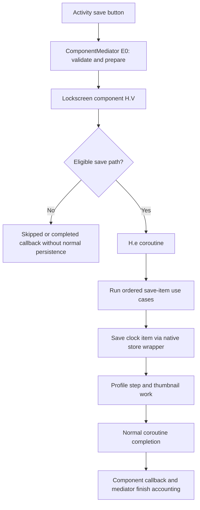

# Dressroom 2.9.60.51: One UI 8.5 inspection

Inspected through the JADX MCP on 2026-10-30. The user supplied this as the One UI 8.5 APK. Its manifest identifies `com.samsung.android.app.dressroom`, versionCode `296051000`, versionName `2.9.60.51`, min SDK 35 and target/compile SDK 36. Manifest metadata lists Object Capture SDK `8.5.8` and wallpaper SDK `8.5.5`.

This pass maps editor-side roles. It does not make the module compatible yet. No runtime source, profiles, installed APKs or phone processes were changed. AOD and SystemUI for this firmware have not been inspected in this pass. The loaded APK's filesystem path/SHA-256 was not supplied by the MCP, so the mapping is not yet an artifact-fingerprint allowlist.

Raw JADX responses are kept locally in ignored `.build/compatibility-85/`. This document records findings without distributing Samsung source dumps. JADX names such as `p213Pa.C1977w0` are display aliases: use the original name `Pa.w0` when resolving a runtime class. The original descriptor `LPa/w0;` was checked in smali.

## Editor and native UI

| Role | Reference build / module dependency | 2.9.60.51 finding | Status |
| --- | --- | --- | --- |
| Editor activity | Named `EditMainActivity` lifecycle | Same named activity and `EditBaseActivity`; component mediator owns save/touch dispatch | Named lifecycle retained |
| Clock preview/panel owner | `vo.x.a(): boolean` | `Pa.w0.a(): boolean` (JADX `C1977w0.mo6634a`) handles click and opens the stock clock panel | Role verified in source |
| Clock model access | Controller `b -> a -> getData()` | `Pa.w0.c` is `b7.Z`, GetObservableClockDataUseCase; its field `a` is the clock repository | New object graph required |
| Panel root | Controller field `Y` | `Pa.w0.h0` caches panel view; private `i1()` inflates it | New accessors required |
| Panel view model | Reference controller/model links | `Pa.w0.e` provides `Pa.L`; its constructor identifies weather/date/font/idle use cases | New model binding required |
| Renderer binding | `oc.a.e(ClockView)` | `com.samsung.android.lockscreen.editor.item.core.util.b.w(View)` stores a ClockView in field `b`; owner `Pa.w0.z` holds the helper | Parameter type changed as well as names |
| Renderer replacement | Main-preview `vo.x.e(ViewGroup, ClockData)` | `Pa.w0.s1(ViewGroup, ClockData)` handles clock type changes; `o1(ViewGroup, ClockData, boolean)` creates ordinary renderers and routes world clock separately | Source role verified; hook timing needs a runtime check |
| Stock panel structure | `clock_panel_layout`, `tab_layout`, `binding_1`, two stock tabs, stock content child | Resource XML retains that structure, two Font/Color and Style tabs, SESL seek bar/switches, and `clock_panel_item_divider` | Structure is reusable for this build |
| Tab callbacks | Top-level `com.google.android.material.tabs.c`, tab field `d` | Nested `TabLayout$d`; tab parameter is `TabLayout$g`, native position getter `o(): int` | Confirmed in `Pa.L` smali; current reflection calls cannot be reused unchanged |
| Bottom toolbar | `v8.y.l()` rebuild | `V3.v.H()` rebuilds the menu and removes/recreates children; `V3.v.d` is its LinearLayout | New toolbar binding required |
| Menu lifecycle | Existing toolbar injection | `P3.m` EditorMenuMediator forwards menu data to `V3.v`; lock component UI adapter `component.g1` supplies native items | Append idempotently after rebuild, respecting native enabled/visible state |

`Pa.w0.a()` refuses dual/roaming clocks before opening the panel. Preserve that native restriction unless a separately implemented renderer path supports it. It also reports different lock/main-cover analytics and panel geometry; changing only the controller class name would miss those differences.

The UI is not a reason to replace Samsung's controls. The XML still has the native elements we need; map the different tab API and owner fields, then reuse our current content layout. Do not assume top-level Material listener classes from the reference build exist in this one.

## Apply is a pipeline, not a button callback

The activity's save button calls `P3.f.E0()` (ComponentMediator). That method checks save conditions, runs preparation, disables the button and invokes each component's save method.

The lockscreen component is `com.samsung.android.lockscreen.editor.component.H`, displayed as `C6889H`. Its `V(T2.O, T2.J)` role is the component save request; the parameter types here are the original names corresponding to JADX's save-base-data and listener interfaces.

Important branches actually present in this APK:

- No lock preview and no cover edit: sends the listener's **Skip** callback.
- Component failure state: logs a save-failure reason but still sends the listener's **Complete** callback.
- Routine entry: can return with **Complete** before the normal save coroutine.
- The mediator's Complete and Skip callbacks both increment its finished-component count and can lead to activity finish. Activity destruction therefore does not establish a successful save either.
- The normal `H.e` coroutine calls its listener after `withContext` returns; its lockscreen branch includes a 250 ms delay in the decompiled flow. Confirm its suspension/return branches in bytecode before implementing a completion interceptor; a delay is not a synchronization API.

The coroutine's inner work sorts `saveItemUseCaseSet` by the native order and runs `V6.e.b()` for each. `b7.e1`, SaveClockDataUseCase, is ordered at `End`. It computes native movable-area/margin data and calls the clock store. It skips dual/roaming clocks.

Main-screen clock store `com.samsung.android.lockscreen.editor.item.data.repository.item.clock.a0.c(...)` converts ClockData to a LockScreenItem and, only when non-null, calls the native lock-item-store wrapper. This is a better place to observe that a clock item was submitted than the generic listener.

**Another trap:** `r7.o`, SaveProfileDataUseCase, is not a reliable replacement success hook. It can skip DeX or an invalid repository, and the main-profile implementation `p6.c.b(...)` merely logs and returns `true`. The cover store is separate (`X5.F` handles SubProfileData). A method named "save profile" is not evidence that it wrote the main lockscreen settings.

Proposed module transaction for this build:

1. Freeze the module draft for a particular editor session/save request after native preparation, before persistence. Establish that preparation boundary in the final binding, rather than moving our current hook to `E0()` blindly.
2. Associate accepted native clock/widget submissions with that same request and capture their final native identity. Guard against dual-clock skips, routine paths and other components' callbacks.
3. Finalize the relevant snapshots only after the normal lockscreen save coroutine completes successfully. `invokeSuspend` can run multiple times and return the coroutine-suspended marker; entry/return alone is insufficient.
4. Keep the generic Complete/Skip listener for accounting/cleanup if useful, not as the sole commit predicate. Exceptions, rejected saves, cancellation and session destruction must dispose only the appropriate pending state.
5. Verify native store acknowledgement and wallpaper-ID timing against the matching AOD provider/runtime. A successful wrapper call establishes submission, not necessarily durable provider persistence.

This is a candidate design supported by the source graph. It has not been implemented or exercised on the target firmware.

## Date, weather and model reuse

`ClockData`, `ClockFontData`, `ClockStretchData` and `ClockDataKt.deepCopy(ClockData)` remain named classes. The method list confirms named accessors for clock type, scale, position, stretchability/enabled state, blur enabled state, weather and date order. This is a useful shared model layer, but generated Kotlin `copy` layouts must still be checked before reusing argument lists.

The weather use case is **`b7.J.a(boolean)`**, displayed as `C5149J.m14919a`. It checks repository validity, changes native `showWeatherInfo`, then notifies the observable repository. Our current `mf.i0.a(boolean, boolean)` assumption is incompatible.

Stock panel `Pa.L` receives that weather use case and a distinct date-order use case (`b7.H`). It exposes native observable weather state to data binding. Use that native model operation rather than only changing a module switch or a renderer's weather flag.

The main clock store reads native weather/blur/font-height state back into ClockData, including `ClockItem.isShowWeather()`, `isBlurEffectEnabled()` and font heights. This provides a target hydration path to inspect when wiring restoration; opening Advanced must not be needed to obtain it.

The clock binding helper still uses named plugin interfaces for operations such as `FontExtension.setFontType(ClockFontData)`, `ClockView.setShowWeatherInformation` through the preview path, and `ClockBlurExtension` operations. Its static helper `b$a` gates blur methods through a feature check; the actual renderer and device blur capabilities still require the AOD APK.

## Depth and wallpaper source

The following signatures are present:

- `ObjectCaptureProvider.getInstance(Context)` returns the named ObjectCapture interface.
- `ObjectCapture` has worker-thread `init`, `capture(Bitmap)` and `release`, plus `isObjectCaptureSupported()`.
- `ObjectResult` has `isCaptured`, `getOutput`, `getObjects`, `getSingleOutput`, error code and solution-info accessors.
- `ObjectInfo` has `getObjBitmap()` and `getBoundRect()`.

That matches the methods used by our current mask extraction path, including combining multiple candidate objects. It is **signature compatibility**, not proof that detection works on every device with this APK. Native libraries and `isObjectCaptureSupported()` still matter, and pixel/rectangle conventions need a fixture or device check.

`CropImageView` remains a subclass of MaskImageView, which follows the ImageView draw path. Its actual `getDrawableInner()` implementation returns `super.getDrawable()`. Its own `onDraw(Canvas)` remains available. Source-image identity and crop tracking can probably reuse the current LiveSubject approach after checking the superclass's transforms and frame clipping.

There is also a non-default-canvas-size draw path: CropImageView records the superclass drawing into a Picture before drawing that Picture. This matters when comparing offscreen captures with the live editor; do not assume every onDraw canvas has view-sized coordinates.

MaskImageView's own draw path was also inspected: it clips a native mask path before ImageView drawing and has a conditional canvas-centered content scale, initialized to 1. That clipping/draw-space contract is separate from ImageView's image matrix; no active non-default use of the scale was established in this pass.

Not yet mapped: the weather SurfaceView owner replacing our reference `i7.g`, complete frame/filter composition and committed runtime wallpaper transforms. Retaining the known getter is insufficient to claim weather/frame/landscape depth support.

## Widget editor and toolbar

The native widget preview is **`ib.l0`** (JADX `C8192l0`), tagged WidgetPreviewItemV2. Its `d()` creates the native root, initializes native grid dimensions, and binds the provider controller. Relevant original fields differ from our current `op.m` mapping:

| Role | 2.9.60.51 field/type |
| --- | --- |
| Native widget wrapper | `a`, a dagger.Lazy holding `O5.i` |
| Context | `b` |
| Widget preview model | `i`, `ib.B0` |
| Observable WidgetData use case | `n`, `p7.l` |
| Current WidgetData snapshot | `I` |
| Native frame root | `J`, ViewGroup |

The wrapper is **`O5.i`**, LockItemManagerWrapper. Its private `r()` obtains IWidgetUIController; `q()` exposes IWidgetSizeManager. Native `changeAlignType` and `onclickChangeWidgetAlign` remain separate calls. Its support check explicitly restricts use to Android user 0.

`WidgetListStoreRepositoryImpl.b(List, WidgetGridData)` retains native module width/height and primary/secondary coordinates in its serialized widget string. It also has a path rebuilding raw module information for tile widgets. Preserve this format and coordinate ownership; do not flatten both orientations into one replacement list.

The bottom toolbar still rebuilds its native child list, so injection must be repeated idempotently after that operation. The mapped rebuild role is `V3.v.H()`, not the old `v8.y.l()`. Native menu routing runs from the lock UI controller `component.g1`, through ComponentMediator and EditorMenuMediator, to that toolbar. Respect its disable/save/visibility lifecycle.

The editor-side wrapper interfaces are present, but actual grid sizing, provider options, widget background blur and doze/wake behavior live in AOD. These remain pending until its matching APK is loaded.

## Next pass

Load the matching **One UI 8.5 AOD APK** next. Inspect:

1. Provider/class-loader entry and AbsClockView/FontExtension implementation.
2. Font data, independent stretch normalizer, native height/doze/media transitions.
3. Clock blur strategy, native outline readiness and separate surface ownership.
4. Complication grid/size/controller APIs behind O5.i, including alignment and host options.
5. Actual lock-item store/apply acknowledgement, media owner and animation callbacks.

Then inspect the matching SystemUI for the native blur host, full-screen artwork layering, input routing and charging-card lifecycle. Current findings justify a separate editor binding; they do not justify enabling the reference provider hooks on the 8.5 APK by name substitution.
