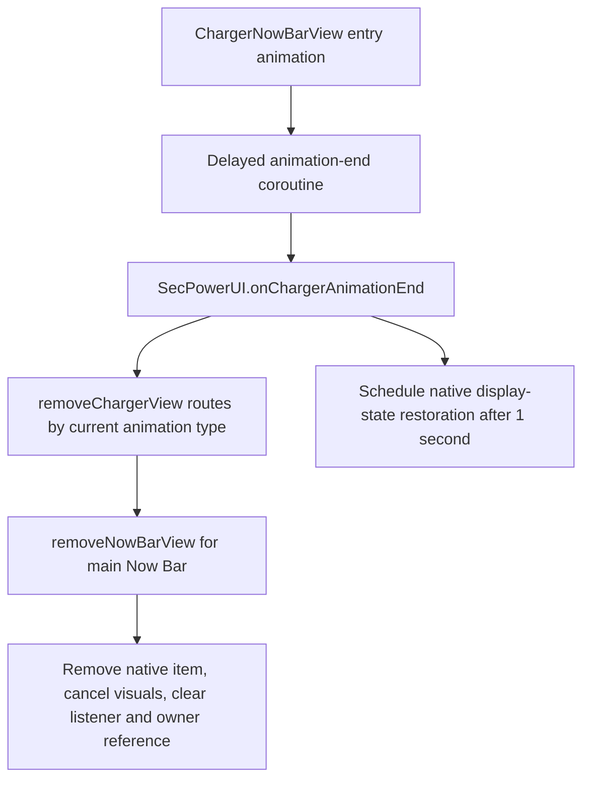

# Older One UI 8.5 SystemUI: SDK 36, plugin interface 4006

Inspected through the JADX MCP on 2026-10-30. The user supplied this as an older One UI 8.5 SystemUI APK available on APKMirror. Manifest: `com.android.systemui`, versionName `16`, versionCode `36`, min/target/compile SDK 36, shared UID `android.uid.systemui`.

The inspected classes carry build text `qb/101698119` and a generated compiled-from signature. This distinguishes the source evidence from the previously inspected SDK-37 input, but does not replace an APK SHA-256. No APK filesystem path, signing certificate or exact device firmware identity was obtained from the MCP.

This is an independent candidate binding, not proof that the three supplied APKs came from one firmware set. No runtime code, module installation, saved setting or phone process changed during this inspection. Raw responses are local, ignored files in `.build/compatibility-85-systemui/`.

## What an older build changes

It is useful evidence even if newer 8.5 firmware differs. The adapter selector must distinguish the actual package/build and native feature contracts. Do not select every 8.5 SystemUI using versionCode 36; that value identifies the Android platform generation here, not a unique Samsung build.

Two concrete findings:

1. PluginKeyguardStatusView reports **major 4, minor 6, VERSION 4006**. PluginFaceWidgetManager returns that constant from `getSystemUIPluginVersion()`. This satisfies the `>= 3005` gate observed in the supplied AOD's widget/media integration. It does not certify all other interfaces, resource layouts or behavior.
2. The reference charging class `power.feature.charginganimation.ChargingAnimationUI` is absent. The equivalent owner in this input is **`power.SecPowerUI`**. A native API can retain its method name while moving to a different lifecycle owner.

## Plugin connection and custom Now Bar

FaceWidgetNotificationControllerWrapper retains:

- `initPlugin(PluginNotificationController, Context)`.
- `mNotificationController` and `mContext`.
- Native `updateItem`, `removeItem`, item-list/root-view access and external expansion callbacks.

The generic bridge used by our custom text card therefore has recognizable source roles in this build. The complete NowBarItem construction/update contract still needs preflight before enabling that feature. Charging retention must not be grouped into the same all-or-nothing installer just because both use the wrapper.

PluginFaceWidgetManager obtains the AOD plugin's actual version on connection and initializes/attaches it through queued UI messages. It exposes PluginKeyguardStatusView.Callback with per-method VersionCheck annotations. Resolve the actual connected plugin and callback capabilities, not just a copy of an interface class found on disk.

When the plugin attaches, SystemUI passes its NotificationPanelView and an insertion index after the edit-mode container to `attachFaceWidgetContainer`. It then retrieves the plugin's container and content-container list. FaceWidgetContainerWrapper tracks that list and treats its first element as the clock container. Preserve plugin replacement/reconnection and ownership rather than retaining old views across a reload.

## Charging: legacy owner needs a separate adapter

Observed source flow:

ChargerNowBarView has a SecPowerUI `animationListener`, `currentBatteryLevel`, charging type, Lottie progress view and an androidx.core.animation AnimatorSet. On attachment it initializes percentage/animation visuals. Its end coroutine delays by the supplied total duration; the inspected attach path supplies 3300 ms, then calls the listener's `onChargerAnimationEnd()`.

SecPowerUI's methods are concrete adaptation points:

- `onChargerAnimationEnd()` calls `removeChargerView()` and schedules `mRestoreDisplayStateTask` after 1000 ms.
- `removeChargerView()` branches on `mCurrentChargingAnimation`, including `now_bar_charging_vi` and separate flip/cover variants; it clears that field afterward.
- `removeNowBarView()` removes the native item through FaceWidgetNotificationControllerWrapper, cancels Lottie and AnimatorSet/listeners, clears `animationListener`, and nulls `mChargerNowBarView`.

Do **not** suppress the whole animation-end callback to keep the card: that would skip native display restoration. The legacy retention adapter needs scoped automatic-timeout handling around removal, its own retained-card ownership and live battery updates, while letting unplug, explicit dismissal and native display/doze cleanup proceed.

The reference `ChargingAnimationUI._uiState.currentOverlay` guard is inapplicable here. ChargerNowBarView also lacks the reference `switchAnimationResources(int)` method, confirmed from its declared method list. Port its actual attach/update/visual lifecycle; simply ignoring that missing method would lose a refresh contract.

Cover charging views and removal branches are separate. Do not claim they work because the main charging pill can be retained. Our common ChargingState/visual settling logic may be reused only after mapping the legacy native fields and animator types.

## Layering and blur

Resource `super_notification_shade.xml` retains NotificationShadeWindowView as a full-screen root, with scrims, `status_bar_expanded`, a bottom `now_bar_rootview`, keyguard/bouncer layers and other overlays. NotificationShadeWindowView has `onAttachedToWindow` and extends WindowRootView; actual parent/layout-parameter compatibility must be validated by the layer adapter.

`status_bar_expanded.xml` has NotificationPanelView and the edit-mode, plugin-frame and other native includes. The inspected static XML does not itself declare `lock_clock_blur`. That matches the need to follow the dynamically attached AOD plugin, not assume that the host is a fixed root sibling in every firmware. The AOD strategy's tag-based blur-host selection was verified in the [AOD inspection](AOD_8.9.32.95.md); its exact constructed hierarchy here remains a runtime/attachment check.

The artwork adapter should validate root, clock/blur host, plugin container, player controls and expanded Now Bar ordering before creating its backdrop. An unrecognized tree must keep the stock player. Retain the shared rule from the compact-clock fix: suppress the live blur host through alpha and let its attached drawable update; never resurrect an old compact drawable on collapse.

PluginFaceWidgetManager exposes distinct blur capabilities:

| Native capability/operation | Observed behavior |
| --- | --- |
| `isBlurSupported()` | Returns `LsRune.LOCKUI_BLUR` |
| `isCapturedBlurSupported()` | Requires `LOCKUI_CAPTURED_BLUR` and DeviceState's captured-blur allowance |
| `applyBlur(View, int)` | Requires SECURITY_CAPTURED_BLUR and the native blur controller; obtains an ALT_VIEW captured bitmap, sets target alpha/background |
| `applyBlur(int)` | Uses the captured-blur repository/binding and native full-screen operation |

A native captured-blur backend is a possible capability distinct from real-time glass blur. This is not evidence that either can be forced on every A-series model. Do not spoof a flagship/device flag globally or create an automatic screenshot/readback loop. Device-specific eligibility and the actual framework backend need verification.

This APK does not provide proof of the framework SemBlurInfo private cloning constructor/fields. Validate those against the target framework at runtime, before installing the clipping hook; keep stored settings intact if unavailable.

## Input routing: the unlock-gap fix needs the upstream gate

`NotificationPanelViewController.isInFaceWidgetContainer(MotionEvent)` calls the plugin's `isInContentBounds(x, y)` on ACTION_DOWN and stores the result in **`mIsFaceWidgetOnTouchDown`**. ACTION_UP returns that stored result and clears it. Other events use the latched state.

Rejecting a later widget/Now Bar dispatch alone therefore cannot restore unlock routing after an oversized hit-test accepted DOWN. The adapter must correct the native content-bound decision for the relevant pill while keeping native dispatch/cancel ownership. Keep the exact native AOD bounds helper as a separate binding; do not assume the reference `aod.di1.D` exists in 8.5.

ActionUpOrCancelHandler calls `onClockClicked` for relevant taps and also calls `onEmptyAreaClicked` in the native tap/cancel flow. These are not mutually exclusive public "close player" events. Media return handling must be idempotent and should track actual expansion/animation completion instead of treating every clock callback as a new return.

The large TouchHandler intercept method decompiles with extensive duplicate/incorrect-looking branches. Its call-site references were inspected, but those reconstructed conditions were not used as an executable binding specification. The small `isInFaceWidgetContainer` method establishes the latch behavior directly.

## Candidate compatibility status

| Feature | Evidence now available | Still needed before enabling |
| --- | --- | --- |
| Native editor controls | Dressroom owner/models/resources and save graph | Adapter implementation, frozen request identity and target runtime tests |
| Clock stretch/depth/blur | AOD owner/render/normalizer/blur roles | Version-bound installation and target framework/readiness checks |
| Custom widgets | Editor wrapper, provider grid and runtime owner | Complete span/picker/host transfer and native surface contracts |
| Custom text card | Named SystemUI notification bridge | Exact card constructor/update/connection capability checks |
| Keep charging card | Legacy owner, timeout, removal and display-restoration path | Dedicated SecPowerUI retention/visual adapter and on-phone verification |
| Full-screen artwork | AOD media holder/card and SystemUI shade/plugin attachment roles | Exact animation owner, dynamic z-order, cleanup and input binding |
| Unlock gap/pill bounds | SystemUI native DOWN latch verified | 8.5 AOD's concrete pill content-hit-test mapping |
| Captured/real-time blur | Separate native capability callbacks identified | Per-device backend and framework support |

The initial three-APK research now supports the adapter split, but not a universal support claim. Next implementation should put the current working reference behind typed contracts and transactional installers, then add these older 8.5 candidates feature by feature. Exact firmware pairing, artifact fingerprints, a One UI 8.0 target, and target-device rendering tests remain outstanding.
