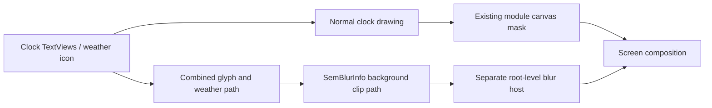

# AOD clock rendering boundary and depth integration

Inspected with the JADX MCP on 2026-10-25. This extends `CLOCK_PIPELINE_AUDIT.md`. No new build was installed during this trace. The installed 0.5.23 idle-depth failure remains unfixed on the phone.

Follow-up: the missing native path hook is implemented in 0.6.0; see release verification and remaining limits. Phone signature/platform checks passed and the user confirmed idle editor depth. Version 0.6.1 also has user-confirmed editor weather restoration. Runtime depth after reboot remains under test.

## Concrete missing rendering surface

`aod.tx0` is Samsung's **CombinedBlurStrategy**, and `aod.cq0` is **ClockBlurManager**.

`tx0.b(ImageView, WeatherInfo, xb0)` does the following:

1. Locates a root-level blur host via `tx0.d()`.
2. Collects each visible clock TextView implementing the path interface `ek8`.
3. Obtains its `getPathForBlur()`, scales by the supplied blur scale, and offsets it using the TextView's screen position relative to the blur host.
4. Adds the weather icon path when present.
5. Passes the combined glyph/weather path to `e70.a(SemBlurInfo.Builder, Path)`.
6. Sets radius/color curve, builds `SemBlurInfo`, and calls `blurHost.semSetBlurInfo(info)`.

`e70.a` uses reflection to invoke Samsung's `SemBlurInfo.Builder.setBackgroundClipPath(Path)`.

The selected blur host is **outside the clock's normal drawing subtree**:

| Provider condition | Host tag selected by `tx0.d()` |
|---|---|
| Ordinary runtime clock context | `lock_clock_blur` |
| Dressroom context, window blur type enabled | `lock_clock_blur_on_lockeditor` |
| Dressroom context, other blur type | `Clock_Blur_Container` |

Raw `AbsClockView.L0` is the Dressroom-context flag. Its constructor obtains it from `context.getOpPackageName()` matching Wallpaper and style. Dressroom's `edit_main_activity.xml` confirms that `lock_clock_blur_on_lockeditor` is a full-size FrameLayout directly under `editor_root`, outside `clock_preview`.

Clipping or erasing the normal clock canvas does not clip pixels produced by that separate Samsung blur host. This is a confirmed coverage gap in the module's current depth hooks, not just a redraw timing hypothesis.

## Why the symptom follows interaction

The Dressroom audit traced `mf.c0` / `bp.l`: blur availability depends on preview idle, effective blur enabled, idleBlur, and layout/animation readiness. Position changes make it ineligible; it returns after native settling delays.

The provider completes that chain:

- `cq0.c()` calls `tx0.b()` to update the separate surface. On success it starts/reuses a blur animation or reapplies its current text alpha.
- `cq0.a()` changes the real TextViews' alpha and the weather ImageView's alpha/tint. Normal text and the separate glyph-shaped blur are deliberately combined.
- `cq0.k()` animates the blur transition over 300 ms.
- Failed path collection retries at 8 ms intervals, up to five retries. Some failures set normal text alpha to 127.
- `cq0.j()` changes weather blur data and regenerates the combined representation when the weather icon/path/enabled state changes.
- `tx0.c()` clears Samsung blur on the separate host.

Thus the verified rendering architecture explains how a mask can affect the clock during interaction and be bypassed when its idle representation appears. This still needs a device check with the **native blur setting genuinely off** and a corrected native path hook before claiming the reported bug is fixed in all modes.

The tested widget contents remain in the container draw path already masked by the module, so they retain occlusion. That observation does not establish that every widget's native blurred background is also clipped; widget backgrounds are a separate validation case.

## Correct integration point

Keep normal glyph/content occlusion and additionally subtract the subject from the native glyph-shaped blur path:

`visibleBlurPath = combinedGlyphAndWeatherPath DIFFERENCE subjectPathInBlurHostCoordinates`

The narrow hook is `e70.a(builder, path)` while executing the owning clock's `tx0.b(...)`. A scoped context can identify the clock through raw `tx0.b -> p67.o` and the host through `tx0.d()`. The existing `BlurEffects` already resolves this owner chain for its blur-radius hook.

Important constraints:

- Modify a copy of Samsung's Path, preserving its native fill type and all glyph/weather contributions; use `Path.op(..., DIFFERENCE)` and handle failure explicitly.
- Use the **same coordinate convention as tx0**. It scales text paths and offsets them by screen positions relative to the selected host. Do not assume the clock canvas and the blur-host path share local coordinates.
- Convert/cache the saved subject alpha mask to a region/path once per wallpaper/mask, then transform it for the current host. Avoid rerunning subject extraction on every frame or minute.
- When depth is off, pass Samsung's original path unchanged and request native regeneration so an old clipped host is not left behind.
- Reapply naturally whenever Samsung rebuilds the blur path: font, time, weather, scale, idle transition, and blur-type changes. A one-time host mask cannot cover all of those rebuilds.
- Multiple clocks can share a root blur host. Use the actual strategy owner and active session/profile; never globally subtract the latest editor mask from every SemBlurInfo builder.
- Preserve normal glyph/content clipping too, because the provider deliberately retains visible TextViews over the blur surface.

This is the code-grounded next implementation; it is not present in 0.5.23.

## Wiring lockscreen and AOD

`UfClockProvider.getClockView(type, category)` delegates to its internal constructor, inflates a provider view, and assigns `Category.getCategory(category)`. The enum explicitly maps AOD=1, LOCK_SCREEN=2, SUB_UI=16, SUB_LAUNCHER=128.

The module already declares SystemUI and AOD scopes and has runtime attachment/font/settings-observer hooks. Those are usable entry points, but their current canvas-only depth behavior is incomplete.

The runtime adapter should:

1. Resolve the native profile/wallpaper/screen and clock identity, then read the committed depth mask through the existing settings bridge. Reuse the editor's saved detection result.
2. Attach normal content occlusion to each new runtime clock and, for any native blur representation, install the same owner-scoped `tx0.b -> e70.a` path subtraction.
3. Distinguish the actual execution process from an AOD APK loaded as a provider inside Dressroom. The package supplying classes is not sufficient to select committed-runtime behavior over the editor's draft.
4. Recalculate the wallpaper-to-host mapping on layout/scale/host changes and ambient burn-in translations. The subject stays anchored to the wallpaper; clock movement changes the overlap.
5. Observe doze transitions. `AbsClockView.setDozing()` changes its dozing flag and blur-related text mode and calls `Z()`; `setDozeAmount()` updates palettes/colors. Rebuild/invalidate the appropriate representation instead of assuming the lockscreen draw survives unchanged.
6. Reapply on committed settings changes and fully clear effects on disable, detach, renderer replacement, or wallpaper/profile change.

For depth alone, use occlusion rather than drawing a color foreground bitmap in ambient mode. A foreground bitmap reconstructed from the normal wallpaper could have the wrong dimming/color or illuminate a subject on an otherwise black AOD. Any foreground display option would need its own explicit ambient policy.

On-phone validation remains required after SystemUI/AOD reload the corrected module. The existing shadow success on AOD does not prove the depth mapping or native blur path is correct there.

## Other findings useful for the artifact fix

- A stale combined blur path can retain old weather/date geometry while the normal content changes. `cq0.j()` and native `setClockTextBlur()` are representation update boundaries to use after the native setting/layout transaction.
- Repeated unconditional native blur calls during layout can restart the 300 ms alpha animation or regenerate a path before measurement is ready. Advanced should participate in native changing/idle flags and rebuild once the transaction settles.
- The existing radius/visibility hooks modify the same native blur manager, so a new depth path hook must compose with those overrides rather than replace the manager or globally clear Samsung blur.
- The earlier normal-canvas, parent, whole-view, and reconstructed foreground attempts did not demonstrate control of this separate surface. Their failed phone results must not be treated as proof that Samsung ignores path clipping.

Source snapshots: `work/clock-audit/aod.tx0.java`, `aod.cq0.java`, `aod.e70.java`, and `aod-render-methods.json`.
