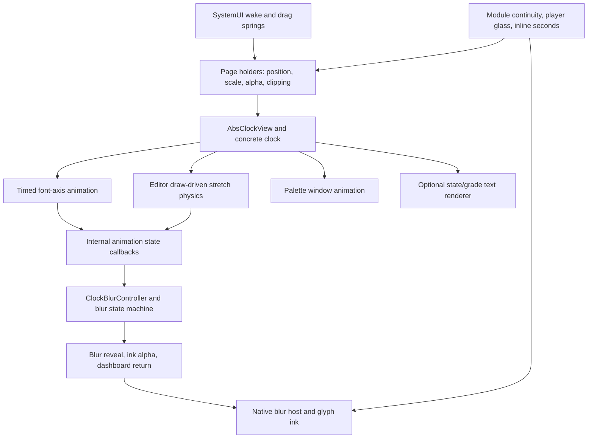

# Clock animation engines

Audit: 2026-11-24. Reference: One UI 9 AOD 8.9.66.1 (896601000),
Dressroom 3.0.10.38 and the matching Android 17 SystemUI/framework.
Compared with 13 distinct AOD/Clock Style APKs, including stock 8.0,
8.5, 9.0, the ported beta and 9.5 beta 8.9.81.55.

The RE pass changed analysis aliases, notes and offline audit rules. It did
not change production rendering, install a preview or establish that the
remaining Natural-blur blink is fixed. Previous handoff implementation and
device checks are recorded in [clock rendering](CLOCK_RENDERING.md).
The subsequent [native animation/color preview](CLOCK_RENDERING.md#native-animation-and-path-color-preview-2026-11-24)
implements the verified completion and color-source corrections. The tables
below retain the native contracts and audited module baseline for comparison.

Use this with the [ownership map](CLOCK_OWNERSHIP_MAP.md),
[layer handoffs](CLOCK_LAYER_HANDOFFS.md) and
[Mistral's exploration notes](AOD_9_EXPLORATION_SUMMARY.md).
Mistral's additional aliases and settings work are preserved. Their chronological
record is [JADX_RENAME_LOG.md](JADX_RENAME_LOG.md); it is not a runtime hook map.

## 1. Engine boundaries

There is no single clock animator. These mechanisms can run concurrently and
finish at different times. A foreground Drawable can schedule physics without
drawing another visible clock; a page handoff can temporarily attach two real
clock instances. Neither case establishes an accidental duplicate by itself.



| Engine | Reference timing / clock | What it writes |
| --- | --- | --- |
| Font-axis spring | 380 ms then 270 ms with 380 ms delay; 650 ms total | Font height and weight, render and refresh |
| Editor stretch physics | Draw-driven; elapsedRealtimeNanos; nominal 8 ms step | Per-slot height, running state, queued font render |
| Palette transition | 300 ms ValueAnimator | Palette stop window and clock callbacks |
| Blur reveal | 300 ms, AccelerateDecelerateInterpolator | Blur background Drawable alpha; end handler restores ink |
| Dashboard return ink | 500 ms ValueAnimator | Glyph color alpha and weather icon alpha |
| Combined blur transition | **1000 ms**, AccelerateDecelerateInterpolator | Ink alpha, weather tint/alpha and blur background alpha |
| Page transition | Per-view options; no universal duration | Bounds, transforms, alpha, clip state and parent ownership |
| State/grade text | 0/500/800 ms state defaults; wall-clock timestamps | State-dependent text rendering and component values |
| SystemUI wake | Real AndroidX springs, not the font timer | Container scale and completion callback |
| SystemUI drag restore | Real AndroidX springs | Container scale/alpha and plugin alpha notification |
| Module inline seconds | Open 420 ms, close 320 ms; ghost return 260 ms | Its own geometry and temporary handoff surface |

These are configured native durations at normal animator scale, not guaranteed
wall-clock completion times under load, reduced animations or duration scaling.
The 1000 ms blur transition still logs a misleading "duration 300ms" message.

## 2. Timed font-axis spring

Reference alias: `ClockFontAxisAnimator`; entry `startAxisAnimation`.
The implementation uses two ValueAnimators in an AnimatorSet, not a physical
AndroidX SpringAnimation.

- Phase one: 380 ms, PathInterpolator(0.25, 0, 0.36, 1).
- Phase two: 270 ms, delay 380 ms, PathInterpolator(0.22, 0, 0.56, 1).
- Height goes from 1 to target plus overshoot, then settles to target.
- Weight reaches 0.5846154 of its first-stage interval, then completes.
- Each frame copies ClockFontData, calls onRenderClockFontData and refreshes.

The direct transition path and timed spring share the same renderer. On the
reference build the spring is selected when animations are permitted, HEGT is
selected, the clock is not dozing and media is not expanded. A start latch
prevents restarting it on every incoming fraction. Weight and height eligibility
are independent; a font with unit heights need not have a height transition.

Starting cancels the old set, then marks spring animation running. Both cancel
and end listeners clear that running flag. They do not themselves restore the
original font. A direct-transition caller can render its interpolated font
after cancellation. Do not treat the listener as the font restoration owner.

### 9.5 adds another path

In beta 8.9.81.55 the corresponding engine also owns a **500 ms shrink animator**,
with PathInterpolator(0.17, 0.17, 0.1, 1). It caches current and target fractions
separately from the spring AnimatorSet. Stopping this shrink animator cancels
it and clears its animator/target references.

The 9.5 shrink frame caches the current fraction and renders it with the latest
media fraction. Its listener records cancellation and skips the final target
render when cancelled. On ordinary completion it stores the target fraction
and explicitly renders that target with the current media fraction. The spring
listener similarly avoids committing its target-fraction cache after cancel,
but still clears the spring-running callback. This is more precise than
assuming every end callback restores the destination unconditionally.

The AbsClockView update now has prototype `(FFZ)V`, compared with reference
`(FZ)V`. ClockFontData copying moved into an engine method, so looking for a
copy$default call directly in AbsClockView misses this entry even with the new
prototype. The audit uses the unique `(FFZ)V` entry as a structural lead and
the shrink log anchor separately; these are not complete runtime bindings.

The page's updateFontDozeAnimFraction log and setDarkAmount/media callbacks
identify the inputs as doze amount and media expansion. The page normalizes
the media direction against its current expansion state before passing it on.
In the engine's render method, weight uses clamp(max(dozeFraction,
mediaFraction), 0, 1). Heights either use that maximum or, under the fullscreen
stretch gate, first blend individual heights toward the largest height and then
blend toward 1 using the media fraction. Spring eligibility also changes under
that gate. A one-fraction backport must not silently discard the other input.
The page also has a pending-until-screen-on update route. Its last rendered
fractions and pending state must be kept distinct from the cached base font.

## 3. Editor stretch physics

Aliases: ClockStretchPhysicsAnimator, ClockStretchPhysicsConfig,
ClockStretchSlotState, ClockStretchFrameDrawable and ClockStretchHeightsFrame.
AbsClockView installs the foreground driver only in Dressroom when the relevant
stretch path is enabled. The foreground drives computation, not a second ink pass.

The default config is acceleration up 0.012, down 0.008, maximum speed 0.06,
speed scale 1, restitution -0.0, nominal frame 8,000,000 ns and time-step scale
clamped to [1, 1.5]. Each slot retains current height, target height, initial
delta, velocity, acceleration, bounds and speed/restitution parameters.
Target heights are constrained to [1, font maximum ratio], with a 0.0001
settling tolerance. Velocity is bounded and height integration uses the
scaled step. Bounds and target crossings can clear or reflect velocity.

The tiny default step does not establish a fixed 120 Hz refresh rate. Work is
driven by actual drawing. A delayed frame is capped rather than catching up
all elapsed time. Smali resolves the decompiled Drawable's invalid-looking
crossing branches. For finite values, its two-phase update is:

```text
stepScale = clamp(elapsedNanos / nominalFrameNanos, 1, 1.5)
for each slot:
    goal = clamp(requestedHeight, 1, maxHeight)
    delta = goal - height
    if abs(delta) <= 0.0001:
        height = target = goal; delta = velocity = acceleration = 0
    else:
        target = goal
        oldAcceleration = acceleration
        acceleration = delta > 0 ? accelerationDown : -accelerationUp
        if oldAcceleration * acceleration <= 0: velocity = 0
    refresh speedScale and restitution from config

for each non-settled slot:
    acceleration = delta == 0 ? 0 : accelerationForDelta(delta)
    nextVelocity = clamp(velocity + acceleration, -maxSpeed, maxSpeed)
    nextHeight = height + nextVelocity * speedScale * stepScale
    if nextHeight <= 1 or nextHeight >= maxHeight:
        height = clamp(nextHeight, 1, maxHeight); velocity = 0
    else if nextHeight reaches/crosses target in the remaining-delta direction:
        height = target
        if (acceleration > 0 and nextVelocity < acceleration) or
           (acceleration < 0 and nextVelocity > acceleration): velocity = 0
        else: velocity = nextVelocity * restitution
    else:
        height = nextHeight; velocity = nextVelocity
```

The `initialDelta` analysis alias means the delta sampled at the start of the
current draw's target update, not an immutable displacement for the whole
animation. The remaining/initial delta ratio is logged; it is not multiplied
into the velocity update. In particular, acceleration is added per draw and
only height integration uses stepScale. Do not replace this with an assumed
Hooke's-law spring or an invented easing/braking curve.

Frame requests are coalesced. A main-thread Handler receives a height payload,
checks that the engine is still started and has a callback, renders a copied
ClockFontData and refreshes. The continue-frames flag determines whether the
draw driver schedules another frame. Stopping removes pending messages, clears
running state/callbacks and removes only the foreground still owned by this clock.

Mistral found the matching settings UI keys. Verified in setStretchAnimator:
the four `aod_stretch_anim_accel_up`, `aod_stretch_anim_accel_down`,
`aod_stretch_anim_max_speed` and `aod_stretch_anim_speed_scale` values are read
when the engine is created. Their existence is not proof of a live setting
observer, and changing them does not configure the separate timed font spring.

The internal-state manager notifies blur callbacks when its combined spring/
stretch running state changes. ClockBlurController registers against the current
clock, unregisters a replaced instance and seeds the blur state machine from
the current internal-animation state. That route can disable native blur while
font motion is still in progress, independently of page-container motion.

## 4. Palette window and state text

PaletteItemTransitionController runs a 300 ms sliding color-stop window. The
window uses integer positions scaled by 10000 and a 5000 stop-gap allowance.
Retargeting a running transition extends its window and resets its current
fraction; it is not necessarily a fresh animator per request.

Its interpolator divides time into three equal segments. Each segment is a
quadratic Bezier with control values [0, .01, .37], [.37, .72, .888] and
[.888, .9999, 1]. It is not linear interpolation. The frame listener either
samples the window or uses PaletteItem.getDiffWithTarget, then invokes
onPaletteTransitionFrame. End compacts the stop window, emits the final frame
and calls onPaletteTransitionFinished. A nonanimated request updates palette
state before cancelling the old animator and issuing its immediate callback.

The callback interface is now ClockPaletteTransitionCallbacks. Do not rename
the entire merged R8 callback classes: their other switch branches belong to
unrelated widgets and animations.

The optional state/grade renderer is another mechanism. Its native state names
are **StateEmpty, StateOff, StateAOD and StateCoverLock**. Smali verifies this
default matrix, before a stored per-pair override:

| From / to | Off | AOD | CoverLock |
| --- | --- | --- | --- |
| Off | 0 | 500 ms | 800 ms |
| AOD | 500 ms | 0 | 800 ms |
| CoverLock | 800 ms | 500 ms | 0 |

Other default pairs, including Empty, are 0. The reference startColorTransition
path initializes component values with zero durations and applies the result
immediately; allocating its color ValueAnimator does not prove that method
starts a color fade. The preprocessing worker has character/picture machinery,
but all four inspected reference setPreprocessingThread call sites pass false.
It is not an established active source of the reported blink.

JADX displays long division in ClockTextAnimatedValue's fraction scale.
Smali converts both operands to float first. The apparent integer-division
bug is a decompiler artifact and must not be "fixed" in hooks.

## 5. Blur alpha writers and completion semantics

| Path | Frame work | Cancel/end side effects on reference 9.0 |
| --- | --- | --- |
| Font spring | Height/weight render | Both callbacks clear spring-running state |
| Palette | Stop-window/palette render | End emits final palette and completion callback |
| Blur reveal | Background alpha 0..255 | Cancel restores target ink; end also finalizes host/background |
| Dashboard return | Ink alpha 255 toward target | Separate timer from font/page motion |
| Combined transition | Ink plus background and weather | Cancel and end call the same final-alpha helper |
| Page "cancel" | Parent-level transforms | Can call AnimatorSet.end, commit destination and remove source |

For reference blur disable, the observable delegate clears the strategy,
cancels its animator, writes ink alpha 127, then cancels reveal and dashboard
animators. Cancellation callbacks can write colors/alpha during that sequence.
It is not equivalent to clearing one SemBlurInfo and leaving ink untouched.

### Verified RGB-source mismatch and version boundary

On reference 9.0, the manager's applyAnimatedTextAlpha respects
NonePaddingTextView's path-mode color. The combined transition frame and
finalizer instead read TextView.getCurrentTextColor. The path-mode int color
setter can update the stored path color separately, so those sources can differ.
This is a confirmed contract mismatch, not proof of the remaining visual bug.

Targeted DEX comparison finds manager path-color reads with no corresponding
finalizer path-color read in both 8.9.36.23 binaries, Clock Style 8.9.35.60,
the inspected 9.0 providers and the ported 8.9.65.74 beta. Older 8.9.32.95
uses the manager's cached base RGB instead. Do not assume the newest color
model applies to it.

**9.5 8.9.81.55 already reads path-mode color in both its combined frame and
finalizer.** Its target alpha also passes through a strategy helper. A blanket
color override would risk replacing that newer policy. Its combined transition
cancel/end listener still calls the shared finalizer, independently of the
shrink animator's cancellation guard.

### Framework end versus cancel

The inspected Android 17 ValueAnimator.end evaluates the terminal animated
value before completing listeners. Cancel normally sends cancellation and
then completion without first evaluating that terminal value. Samsung's own
completion listeners may still write terminal state in either case.

The framework also contains an opt-in deferred-end-listener path: natural
frame completion can queue the end callback through AnimationHandler, whereas
forced end/cancel consume pending completion differently. Activation in the
SystemUI process was not established; no setter call was found in the inspected
framework.jar. Treat this as a conditional ordering contract, not an active
root-cause claim. Do not globally switch framework animator behavior.

### The module actively participates

At the audited baseline, ClockBlurContinuity.settle called ValueAnimator.end after native reveal
and combined-transition entry points. Dashboard return has a returning-clock
exception, but the combined transition is still forced to its endpoint.
That committed final ink/background state while the font/page engines could keep
moving. Calling native code first does not make this an untouched native path.
The follow-up preview removes those forced endpoints and uses a draw-ready,
signature-validated native force-refresh path during an existing reveal.

MediaClockContrast owns another renderer: artwork-backed glyph masks and their
readiness state. MediaBlurHost owns native host holds. Inline seconds adds its
own progress/ghost animators and a 950 ms media-follow window. These lifetimes
must be included when attributing a blue or unblurred transition frame.

## 6. Page and SystemUI animation ownership

FaceWidgetTransition uses per-view duration, delay, interpolator, pivot and
clip options. It animates bounds/transforms and temporarily attaches source and
destination content. Its cancel path can end the set, remove the outgoing view,
attach the destination, restore saved visibility/clip state and reset holder
height. It is a destination-commit operation, not a freeze-current-frame API.

The page synchronizer counts pending participants and queues completion until
the group is finished. Cancellation and ordinary completion have different
cleanup routes. A transition-wide finish does not prove every independent
glyph/blur animator has ended. Likewise, a finished font animator does not
establish the current holder's final screen coordinates.

SystemUI's screen-on affordance uses actual scale springs (stiffness 150,
damping ratio 1). Its completion counter dispatches the plugin screen-on/off
animation-end callback only after participating axes finish. Drag restore uses
separate scale/alpha springs (250/.7 and 550/.96). Those host callbacks and
alpha notifications are another blur-policy input, not font-axis completion.

SubLauncherStretchWeightTransitionHelper is a layout/measurement helper with
glyph-width bookkeeping and pre-draw work. Its name alone does not make it
another timed animation engine.

## 7. Cross-version evidence and reproduction

The reusable rules are [clock-animation.tsv](../../scripts/apk-audit/clock-animation.tsv).
They use named SDK entries, prototypes, calls and distinctive strings, never
an obfuscated class alias as a runtime key. Each match is an audit lead;
the prototype-only 9.5 rule needs body/caller validation before runtime use.
Absence of a reference shape does not establish absence of the whole feature.

Final scan: **13 distinct APKs, 22 rules, 286 checks: 226 unique matches,
60 absent shapes, zero ambiguous shapes.** Some rules intentionally describe
mutually exclusive generations, so the counts below are not feature grades.

| Provider | App version | SHA-256 prefix | Unique shapes / 22 |
| --- | --- | --- | --- |
| AOD | 8.9.15.50 | `ca9197daf79a` | 10 |
| Clock Style | 8.9.15.39 | `6579347551c4` | 10 |
| AOD | 8.9.28.18 | `02ae3a7b32ce` | 17 |
| AOD | 8.9.32.95 | `9afd419f2cb3` | 17 |
| AOD | 8.9.36.23 | `4dce599dcb0d` | 17 |
| AOD | 8.9.36.23 | `ea8ad221a10c` | 17 |
| Clock Style | 8.9.35.60 | `5aabeee49653` | 17 |
| AOD | 8.9.57.1 | `cb5b0bce22e1` | 20 |
| AOD | 8.9.65.81 | `077da1810d9c` | 20 |
| AOD ported beta | 8.9.65.74 | `706a046f88b2` | 20 |
| Clock Style | 8.9.65.92 | `55cb7b857f86` | 20 |
| AOD reference | 8.9.66.1 | `1d1b07db9855` | 20 |
| AOD 9.5 beta | 8.9.81.55 | `55557795719b` | 21 |

The editor draw/request/install, palette start/frame, grade color/worker and
page cancel/finish/options shapes each resolve uniquely in all 13 APKs.
The reference blur manager/transition entries resolve in 11, with stock 8.0
lacking those native glass shapes. The timed spring and reference config
string resolve in six. The `(FFZ)V` update and shrink anchor resolve only in
9.5; its old `(FZ)V` shape is absent as expected. Older physics still exists
despite lacking the reference config string.

Additional targeted method inspection confirms 300 ms palette construction
in all 13, 300/500 ms reveal/dashboard entries in the 11 native-glass providers,
and 1000 ms combined transitions in those 11. These constant/call facts do not
establish runtime animator scale or callback ordering on a device.

```powershell
$providers = @('path/to/AOD.apk', 'path/to/ClockStyle.apk')
./scripts/apk-audit/run.ps1 -Apk $providers -JadxJar $env:JADX_JAR `
    -Rules scripts/apk-audit/clock-animation.tsv `
    -OutputDir .build/clock-animation-audit/report
```

The scanner uses the existing .build/module.jar and handles DEX 041 sections.
Inputs are deduplicated by hash; the two 8.9.36.23 variants remain distinct.
Reports, selected-class source/smali, method facts and raw tool rename results
stay in the ignored .build/clock-animation-audit directory. No Samsung source
or APK is added to the public repository.

## 8. Next fix boundaries and remaining RE

1. Implemented in the native-animation preview: retain actual animator
   completion and refresh draw-ready geometry through the validated force path.
   Visual ink/glass continuity through media/seconds motion still needs checking.
2. Implemented: scoped path-RGB reads on affected writers, preserving 9.5's
   implementation and earlier inherited-setter behavior.
3. Model editor physics, timed axes, page transforms and SystemUI wake blockers
   separately. Bind state to a concrete clock instance and display.
4. Finish the secondary measurement/provider callers of the 9.5 shrink path
   before changing its fraction handling. Compare the resizing blur host's
   per-frame layout and draw readiness with those fraction caches.
5. Every clock style's optional grade renderer, fold/cover permutations and process-specific framework
   deferred-callback activation are not exhaustively proven by this pass.

This provides concrete engine contracts and version boundaries for the next
fix. A signature match or a semantic rename is not a visual regression test.
