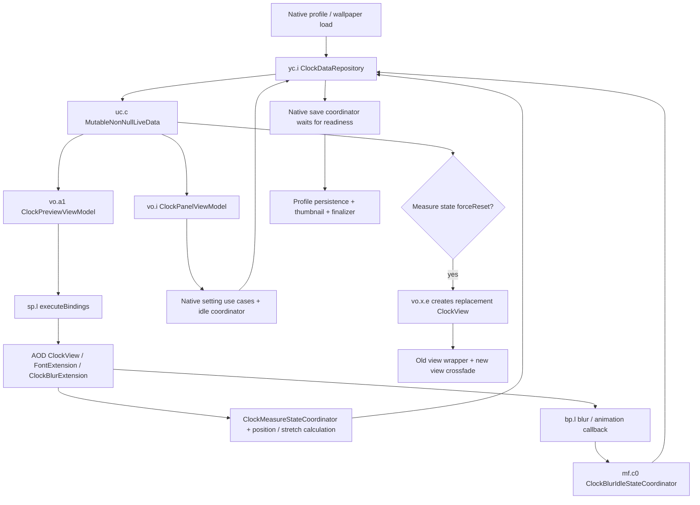

# Dressroom clock lifecycle audit

Inspected 2026-10-25 with the JADX MCP against Dressroom 3.0.10.38 / 301038000. Source snapshots are in `work/clock-audit/`. This is an analysis pass: no new APK was built or installed during this pass. Installed test baseline remains 0.5.23. Its idle depth failure is unresolved.

Implementation follow-up: 0.6.0 release and verification record. The findings below describe the inspected baseline; later source changes and their validation are recorded separately.

## Evidence and confidence

- **Verified source behavior** means the method body or smali was inspected.
- **Module defect** means the current module demonstrably diverges from that contract. It does not establish that the defect explains every reported visual symptom.
- **Open rendering question** means a provider implementation or device observation is still required. Earlier claims that an old crossfade view, stale coordinates, or the temporary font identity alone explained the idle depth failure were hypotheses; builds through 0.5.23 did not validate them.

## Native data and rendering flow

### 1. Repository and notification semantics

`yc.i` (`p501yc.C7883i`) owns live `ClockData`. Its `setData` marks the repository valid and delegates to `uc.c` (`p413uc.AbstractC7014c`). `setData(data, true)` calls LiveData `setValue`; `false` calls `postValue`. The Boolean controls notification timing, not persistence. Native use cases often mutate the current model and post the update.

`ClockData` includes native weather, date order, blur, stretch support, scale, position, measured bounds, and suggestion state. Native persistence is a later transaction; publishing a model does not save it.

`ClockDataKt.deepCopy` copies the outer models and selected geometric values. Nested objects and collections can remain shared. In particular its `ClockColorData.copy$default` retains the same `ClockShadowStyle` reference. It must not be treated as a fully isolated arbitrary object graph.

### 2. Clock construction and replacement

`vo.x.b()` (`C7374x.mo1413b`) inflates `clock_item_layout`, binds the preview view model, stores its FrameLayout as raw field `g0`, and calls `vo.x.e(ViewGroup, ClockData)`.

`vo.x.e()`:

1. Records `ClockInitStarted`, clears old listeners/controllers, and takes the previous last child.
2. Obtains a fresh provider view through `pc.b.f`, ultimately `ClockManager.getClockView(type, providerMode)`.
3. Registers the view in `oc.a.e`, adds it to `clock_preview` with alpha zero, then configures date order, weather, blur callback/type, font, stretch heights, width, and editable mode.
4. Refreshes, measures, registers layout callbacks, and initializes size/position/stretch.
5. Stores the current view separately as raw `c0` as well as in `oc.a.a`.
6. May move the outgoing view into a temporary FrameLayout beside `clock_preview`, with matching scale/translation. It either removes that wrapper immediately or fades it out over 300 ms. The new view fades in after a 160 ms delay.

`vo.k` case 2 recreates the clock when the model's measure state has `isForceReset()`. Opening a tab is not the only lifecycle boundary. A module must track the current renderer generation and retire all effects/queued work for previous generations.

The crossfade wrapper is real, but source inspection alone does **not** prove that it is responsible for the persistent idle depth failure. The fade update removes the wrapper once alpha reaches zero.

### 3. Native binding is a second writer to the provider

`sp.l` (`p383sp.C6792l.executeBindings`) finds the ClockView under `clock_preview` and applies:

- dozing and doze amount;
- stretch animator enablement;
- actual weather visibility and date order;
- native color and shadow;
- font, font variation, and optional manual stretch heights;
- frame scale, position, gravity, and separate time/date geometry;
- blur enablement, blur type, blur removal/addition, and text blur regeneration;
- calendar bitmap for calendar clock type 50001.

`vo.b.b` caches a tag containing color/shadow/font-color/scale inputs before changing the provider. It divides shadow radius and offsets by the effective scale. `vo.b.c` passes stretch heights only when native stretch is enabled.

Direct provider calls from Advanced can be superseded by the next binding pass. Conversely, changing the provider without changing the model/tag can leave the binding believing the view is already current. This is why an unconditional invalidate is not a complete synchronization strategy.

### 4. Interacting versus idle is an explicit state machine

`mf.c0` is named **ClockBlurIdleStateCoordinator**. It combines clock-assist idle state, preview eligibility, position changes, wallpaper/scroll activity, and layout-changing state.

- `ClockAssistData.isClockIdle()` is false while changing clock internal settings, clock type, or font type.
- `mf.v` emits false immediately when the clock position rectangle changes, waits 300 ms, then emits true if the position stayed still.
- Internal animation completion also waits 300 ms before becoming eligible.
- `mf.b0` adds a further 300 ms wait before setting an idle blur value true; setting it false is immediate.
- `mf.h2` writes that value to `ClockData.idleBlur` and publishes the model.
- `bp.l.isClockBlurAvailable()` requires preview idle, effective blur enabled, and `idleBlur` simultaneously.
- `vo.a1` derives binding inputs that add/remove blur and rebuild its text representation. Blur type changes explicitly remove old blur, set the type, regenerate text blur, and clear idle blur until eligible again.

This is a verified native transition closely matching the interaction-only symptom. The final AOD window/path blur implementation still needs tracing before declaring it the depth root cause. The renderer must be inspected with native blur on and off independently of the module's custom shadow.

### 5. Stock controls enter and leave that state machine

The native clock panel is `vo.i` (`C7344i`); the palette model is `yo.q` (`C7939q`). `vo.i.c` calls `mf.s2` (**UpdateClockIdleUseCase**) to mark an internal edit beginning/ending. `mf.r2` publishes the clock-assist flags.

For date order, `vo.g` marks an internal setting change, updates the model, waits 300 ms, then clears the change flag.

For weather, `vo.g` performs a richer sequence:

1. Updates its switch LiveData, marks layout-changing and internal-setting flags.
2. Waits 100 ms, writes `ClockAssistData.showWeatherInfoReservedValue` through `mf.i0.a(value, true)`.
3. `vo.q` observes that reserved value, applies it to the provider for measurement, calls `measure`, obtains `ClockPositionInfo`, updates clock bounds, and initializes stretch data.
4. After another 100 ms, `mf.i0.a(value, false)` writes actual `ClockData.showWeatherInfo`.
5. After 300 ms more, releases the internal/layout change flags.

The reserved value is a native measurement input, not an extra persisted weather toggle to invent. Native `ClockData.showWeatherInfo` remains the actual weather setting.

### 6. Measurement, stretch, and position are coupled

`mf.d0` (**ClockMeasureStateCoordinator**) tracks initialization and requested size/position data, publishing changes to the same model. `mf.h1` completes initialization. `mf.i1` reads provider stretch measurements, validates/caches them, and converts them for gravity/visible size.

`mf.j2` (**SetValidClockPositionUseCase**) can realign the clock after measurement. It avoids initialization/force-reset states, then uses native position calculations and publishes corrected X coordinates. Other position operations use the native position repository and measured bounds. Date/weather row changes therefore need the native measurement flow, not only TextView visibility updates.

Manual stretch must hold the intended segment heights without blocking legitimate remeasurement or restoring old geometry over newer edits. Turning depth off also needs an explicit policy for a manual hold that existed before depth was enabled.

### 7. Profile reload and wallpaper-scene geometry

`dc.g0` (`C3064g0`, **LockScreenObserverInitializer**) observes clock, wallpaper-scene, assist, alignment, and measurement changes. Among its dependencies is `mf.c` (**ApplyWallpaperClockBundleDataUseCase**), so initial view creation is not the last model restore boundary.

`mf.t1` (**ManageLifeCycleClockDataUseCase**) validates the font and movable area, then loads `WallpaperClockBundle` for the focused wallpaper scene. It applies that bundle back to the live clock model. For a non-reedit lifecycle it can reset suggestion/stretch data and region cache, then update the scene bundle. `mf.c` can also select a primary or cached scene bundle and apply it while temporarily suspending alignment, then synchronize widget/notification assist data.

The converter `yc.b0` (`C7870b0`) restores **font heights, gravity, horizontal/top/bottom margin ratios, translation, offsets, scale, and supportStretch** from that bundle. When converting the live clock to a bundle for saving, it includes font heights only if `ClockData.getStretchEnabled()` is true. That property is the conjunction of compatible clock/font stretch capability and `supportStretch`.

Therefore type/font identity alone cannot identify the geometry being restored. A manual height hold in module memory can disagree with the native scene bundle if its stretch enablement or scene identity is stale. A solution must restore at the native profile/scene boundary and preserve the user's current scene edits through subsequent observer passes.

### 8. Apply, thumbnail, and reopen

`dc.p.Y` validates the lockscreen save request and its profile identity, then invokes the lockscreen save coordinator. Its dependencies explicitly separate environment/session preparation, readiness waiting, artifact preparation, persistence, thumbnail save, and finalization.

The coordinator coroutine (`ic.b`, confirmed in smali where JADX omits the body) waits for `SaveState.ReadyToSave`, prepares the thumbnail state, waits for `Done`, saves the thumbnail, and finalizes. A routine entry can complete its save session immediately through a separate branch.

`vo.x.d()` prepares a thumbnail by suspending animation and fixing the preview time. This is a native thumbnail contract, not a normal refresh operation.

The module's current callback target is authentic: raw `androidx.work.impl.utils.c.invoke`, discriminator 5, raw `c` field `dc.p`, logs `save: onSaveCompleted` and reports lockscreen completion to the mediator. However the module currently commits the latest global draft before running the callback body. There is no frozen, profile-scoped extras snapshot captured alongside the native save request, and no explicit flush of the Advanced pending edit queue before native save capture.

## Confirmed module integration defects

| Defect in current source | Consequence / affected flow | Required correction |
|---|---|---|
| `NativeClockPanel.refresh()` restores saved shadow/blur/manual into the repository on first Advanced selection | Tab entry can overwrite edits already made in Font and Color or Style | Restore extras at editor/session initialization; opening a tab must only read the live draft |
| `weatherPreference` is loaded from extras while native `showWeatherInfo` is not synchronized; cached value wins in `stage()` | Switch state, rendered weather, and native model can disagree; stock changes can be saved with stale extras | Use native model as the weather authority and its reserved/measurement update sequence |
| Advanced weather/date/blur edits bypass native internal/layout-changing flags | Idle blur can rebuild during an unfinished setting/layout transition | Route edits through the native edit transaction and release flags after native readiness |
| `renderer` is reacquired on `refresh()`, but `flush()` and delayed refresh callbacks keep an older reference | A new clock can appear while queued work affects the outgoing clock | Bind work to the active renderer generation; cancel retired generation work |
| `EditorClockRefresh` creates a provider timer and temporarily clears fixed-time state for each refresh | Bypasses normal provider timing/thumbnail contracts; queued work has no session/generation check | Use the native update boundary and rebuild only the representations invalidated by the change |
| Global draft and effect caches have inconsistent lifetimes and separate sources of truth | Late committed settings can disagree with the current editor draft | One editor session state owner with explicit create, update, cancel, and successful-save transitions |
| SettingsProvider keys extras only by clock type and font | Two wallpaper/profile contexts using the same clock share extra settings and subject mask | Add native profile/wallpaper/screen identity and a documented migration |
| Save commits whichever extras bundle is current at callback time | Pending or later edits can differ from the native captured save | Flush edits and freeze extras at native save start; commit that exact snapshot on completion |
| `ClockDataKt.deepCopy` shares nested shadow objects | Snapshot isolation requires care. Rechecking the panel confirmed its existing `shadow()` setter already replaces the value; the audit's original claim that this setter mutated in place was incorrect | 0.6.0 also isolates the nested shadow when creating restore snapshots |
| Editor custom-shadow application uses raw offsets/radius while native binding normalizes by scale | Binding, preview override, and runtime can disagree about shadow geometry | Normalize once in a common render adapter using the actual view scale |
| `ShadowEffects.apply(false)` / refresh paths blindly clear the view RenderEffect | Effect ownership is not explicit; concurrent writers can overwrite each other | One composed effect owner that preserves/rebuilds required native effects |
| Date hiding changes TextViews/margins but leaves native date capability/order geometry and measurement flow intact | Native above/below/size calculations can still reserve a date row | Compute effective visible row geometry through native measurement, retaining weather-only layout |
| Depth editor enabled/mask/transform fields are process-global and late callbacks can outlive the originating view/session | Old wallpaper coordinates or settings can be applied to newer previews | Scope depth state to the session and active preview host; validate generation on every async completion |
| Several provider hook install sets are marked installed before all optional hooks succeed | A partial failure may suppress a later retry | Track hook capabilities individually and complete or roll back partial installation |

## Remaining rendering questions - do not claim fixed

1. **Provider boundary now traced:** see [AOD_RENDER_PIPELINE.md](AOD_RENDER_PIPELINE.md). `tx0` combines glyph/weather Paths and assigns `SemBlurInfo` to a separate root-level host via `setBackgroundClipPath`. That host lies outside the current clock-canvas mask. Subtracting the subject from that native Path is the missing integration point; the corrected path and real native-blur-off case still require device validation.
2. Establish which provider view/layer supplies the visible idle pixels and whether a foreground image or native blur copy is recreated after layout/time updates. Lack of an intercepted TextView `onDraw` event does not prove the TextView is unused; hardware display lists and overrides must be considered.
3. Verify preview coordinate mapping against native transform and wallpaper crop at one fixed placement. Prior mapping changes did not fix the failure.
4. Check process identity when AOD's APK is loaded into Dressroom. `onPackageReady` currently chooses runtime hooks by package name alone, while plugin ClockViews can have `LOCK_SCREEN` category inside Dressroom. Logs showed runtime discovery starting in the Dressroom PID; this is a process-isolation risk, not proof that runtime provider hooks installed there.
5. Capture a complete foreground-overlay attempt: current logs showed no overlay attach/draw event. Therefore 0.5.21-0.5.23 did not prove that an attached overlay rendered and was covered by a sibling. Check enabled/mask selection, host attachment, file decode, and completion acceptance before further layering changes.

## Implementation order after the remaining renderer trace

1. Introduce an editor session adapter that observes the native model and owns a current renderer generation. UI tabs read that adapter. Restore committed extras once when a profile is loaded, never on tab entry.
2. Route weather/date/blur/manual edits through native changing/measurement boundaries; synchronize native and module fields before returning to idle.
3. Replace timer-based redraw guesses with effect-specific invalidation after native binding/layout has settled. Retire outdated effects and callbacks on replacement.
4. Freeze the native identity and extras together at save start; preserve cancel semantics; commit only that save's snapshot.
5. Place depth in the verified final render representation for normal and blurred clocks, then verify editor, lockscreen, and AOD separately.

## Acceptance checks

- Open a saved editor without selecting Advanced: date/weather/manual/shadow/blur reflect the saved state.
- Change native settings in each stock tab, then open Advanced: tab entry does not revert those edits; reverse direction also stays synchronized.
- Toggle weather/date repeatedly with blur enabled and disabled; check immediately and again after the native idle delays.
- Drag/release and resize/release; depth remains while idle and through the next minute change.
- Change clock/font while an update is queued; the retired view cannot apply a late update to the new selection.
- Change a slider and immediately Apply; native geometry and extras belong to the same saved snapshot.
- Cancel a modified editor, reopen, and switch wallpapers/profiles using the same type/font; drafts and masks do not leak.
- Reopen, reboot, and compare Dressroom, lockscreen, and AOD only after the appropriate processes load the tested build.

## Symbol index

| Raw APK symbol | JADX MCP symbol | Role |
|---|---|---|
| `vo.x` | `p441vo.C7374x` | Clock preview item, creation/replacement, panel opening, thumbnail preparation |
| `vo.a1` | `p441vo.C7324a1` | Clock preview view model |
| `sp.l` | `p383sp.C6792l` | Generated clock item data binding |
| `vo.b` | `p441vo.AbstractC7325b` | Font/color/shadow/calendar binding adapters |
| `vo.i` | `p441vo.C7344i` | Stock clock panel view model |
| `vo.g` | `p441vo.C7340g` | Weather/date control transactions |
| `vo.q` | `p441vo.C7360q` | Reserved weather value and pre-layout bounds measurement |
| `yo.q` | `p511yo.C7939q` | Palette panel model |
| `yc.i` | `p501yc.C7883i` | Clock repository |
| `uc.c` | `p413uc.AbstractC7014c` | Repository LiveData notification semantics |
| `mf.c0` | `p260mf.C5441c0` | Clock blur idle state coordinator |
| `mf.v` | `p260mf.C5517v` | Position movement/300 ms idle transition |
| `mf.b0` | `p260mf.C5436b0` | Delayed idle blur update |
| `mf.h2` | `p260mf.C5464h2` | Writes ClockData.idleBlur |
| `bp.l` | `p035bp.C1549l` | Provider blur availability/animation callback |
| `mf.s2`, `mf.r2` | `p260mf.C5508s2`, `p260mf.C5504r2` | Clock-assist changing flags |
| `mf.i0` | `p260mf.C5466i0` | Reserved and actual weather setting |
| `mf.d0` | `p260mf.C5446d0` | Clock measure state coordinator |
| `mf.h1`, `mf.i1` | `p260mf.C5463h1`, `p260mf.C5467i1` | Size initialization and stretch measurement |
| `mf.j2` | `p260mf.C5472j2` | Post-measurement valid clock position |
| `dc.g0` | `p080dc.C3064g0` | Live clock/wallpaper/assist observer initialization |
| `mf.t1` | `p260mf.C5511t1` | Clock lifecycle reload and scene-bundle restore |
| `mf.c` | `p260mf.C5440c` | Apply primary/cached wallpaper-scene clock bundle |
| `yc.b0` | `p501yc.C7870b0` | Convert native scene clock geometry and stretch heights |
| `pc.b` | `p319pc.C6064b` | ClockManager wrapper |
| `ah.g` | `p013ah.C0140g` | Provider extension adapters |
| `dc.p` | `p080dc.C3088p` | Lock preview controller / native save entry |
| `ic.b` | `p178ic.C3963b` | Save coordinator coroutine; use smali for omitted body |
| `androidx.work.impl.utils.c` | `androidx.work.impl.utils.C1431c` | Native lock save completion callback, discriminator 5 |
