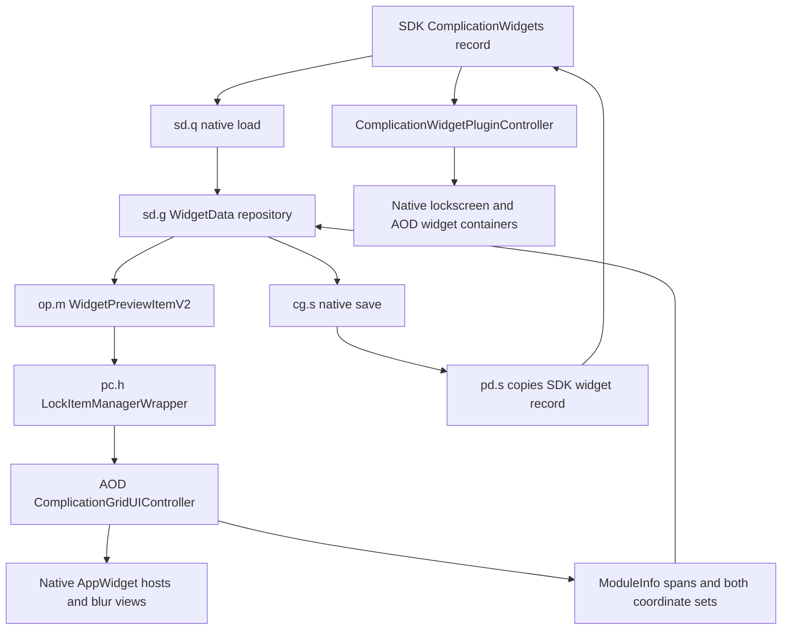

# Widget customization: Dressroom and AOD audit

Inspected with the JADX MCP on 2026-10-26. Dressroom is 3.0.10.38 / 301038000. AOD provider sources were captured before switching JADX back to Dressroom. Source snapshots are in work/widget-expansion-audit. Raw obfuscated names below are the names used by reflection in the installed APK; JADX aliases are included where useful.

This document began as the pre-implementation design for the confirmed 0.6.6 baseline. Versions 0.7.0-0.7.1 subsequently added controls, but the user reported broken layout and scrolling. The [native-feature inventory and integration-defect analysis](WIDGET_NATIVE_FEATURES.md) supersedes assumptions in this design. Independent widget depth is confirmed after SystemUI reload; custom layout is not validated.

## UI decision

Use a native **Advanced** item in the editor's bottom toolbar, opening a panel with a **Widgets** page. Keep the existing clock Advanced tab focused on the clock. The widget selector can gain a shortcut to the same Widgets page later.

The native widget selector is a RecyclerView of providers, not an existing tabbed settings panel. It participates in real AppWidget ID allocation and native grid drag-and-drop. Adding grid-wide controls there is possible, but introduces another selector state and couples arrangement settings to provider selection. A bottom-toolbar page also accommodates the user's future non-clock settings.

The toolbar integration can use Samsung's actual menu model, item layout, ripple, spacing, enabled state, and accessibility handling:

| Responsibility | Raw class / method | JADX alias / evidence |
|---|---|---|
| Phone editor creates toolbar | `EditMainActivity.Y()` | `EditMainActivity-Dressroom.java` |
| Toolbar model array and rebuild | `v8.y.g`, `v8.y.l()` | `p433v8.C7163y` |
| Menu model | `k6.m` | `p214k6.C4336m` |
| Native menu item renderer | `v8.v.b(model)` | `p433v8.C7160v` |
| Native panel host | `v8.j0` | `p433v8.C7145j0` |
| Panel state/anchor controller | `dc.h1` and `k6.o` | Used by `op.m.a()` |

`k6.m` supports a Runnable, stable string tag, resource/bitmap icon, and custom label (`stringId = -1`, raw field `f`). `v8.y.l()` removes and rebuilds all child views, so a one-time inserted View would disappear. Insert one native model idempotently before rebuild, with a module-specific tag. Do not confuse this toolbar with the clock's `MenuItemData` / `MenuItemType`, which handles a different menu.

Reuse the native panel host and existing host-styled controls. Avoid adding a fake panel enum or transforming the editor root. Panel entry/exit must not invoke clock settings setters merely to populate controls.

### Proposed control arrangement

| Group | Controls | Meaning |
|---|---|---|
| Layout | Horizontal / Vertical; Columns; Rows | Grid direction and capacity |
| Size | Widget scale | Physical cell size, independent of capacity |
| Placement | Below / Above / Left / Right / Free; Gap; Alignment | Dock to clock geometry or detach |
| Free position | Horizontal / Vertical position | Shown only for Free; uses actual layout and touch bounds |
| Appearance | Subject depth; Background blur | Widget-specific effects |
| Reset | Reset widget adjustments | Restore native arrangement policy; retain selected widgets and their IDs |

Keep advanced numeric options behind expandable groups. Display the current value and provide a reset per group. Preview changes live, but persist only through the editor's native Apply. Blur should initially offer **Samsung default / Off**; a Force on mode requires separate compatibility validation because native accessibility and AOD policies also control blur.

## End-to-end ownership



The native widget owner must remain responsible for host listening, ID binding, provider updates, and AOD transitions. The module should override geometry/policy at the relevant boundary rather than construct replacement widget hosts.

## Grid capacity, orientation, and larger widgets

### Native AOD behavior

`ComplicationWidgetSizeManager` has distinct device gates for grid dimensions and packing rules:

- Normal phone: **4 columns × 1 row**. Changing only `WidgetAlignType` does not change these getters to a vertical phone grid.
- Supported larger-device paths: horizontal **8×2** or **10×2**, vertical **2×8** or **2×10**, depending on device and feature gates.
- `isBiggerSize()` separately selects larger-grid rules. Overriding rows/columns alone leaves the normal phone packing policy active.
- Normal `ComplicationFitPositionRule` primarily packs horizontally. The larger-grid rule set includes orientation-dependent pivots, sorting, drag/drop, position migration, and gap compaction. `DisallowEmptyRowPositionRule` also compacts empty columns.
- `changeAlignType()` updates both controller and size manager, then reconfigures grid rules and dimensions. `initGridLayoutSize()` and the root-container size must agree.
- `_scaleFactor` affects native cell size. Initialization also fits a target width against grid dimensions; expanding capacity can otherwise shrink the cells automatically.

Do not globally spoof the phone as a tablet. Scope grid/capacity overrides to the selected widget grid and choose compatible rules explicitly. Preserve notification, wallpaper, cover-display, and other tablet-dependent behavior.

### Dressroom's independent gates

`sd.h.a()` (`sd.C6678h`) reads `IWidgetUIController.getLockWidgetGridSize()`, falls back to `(4,1)`, then writes `WidgetGridData`. It swaps rows/columns for vertical mode only when its third argument allows that path. Changing the provider dimensions without updating Dressroom's grid model can produce different preview bounds and packing decisions.

`sd.d.a()` (`sd.C6674d`, AvailableTileStoreRepositoryImpl) explicitly filters **two-row** tiles out on normal phone lockscreen mode. Tablet/multifold lockscreen and sub-grid modes use different eligibility. It also preserves provider visibility restrictions, including `widgetFeatures & 2`; retain those restrictions when exposing supported larger variants.

The native shared widget facade has another size table and capability path. Its inspected size-code query uses bits **1, 2, 8**, decoded by `d20` as tiny, small, and medium. Additional named sizes exist in the enum/decoder, but their existence does not establish provider support. AOD's preview size map contains 1×1, 2×1, 2×2, 4×2, and 4×4 dimensions; this also does not guarantee every app supplies those layouts.

**Implementation requirement:** coordinate the picker filter, facade-advertised sizes, native size table, grid rules, actual host options, and Dressroom bounds. Expose only sizes supported by the selected provider. Reject a grid reduction that cannot fit the current widgets; do not silently drop IDs or truncate the serialized list.

### Scaling and cached metrics

`sd.o` (`sd.C6685o`, WidgetSizeRepositoryImpl) caches the native size manager, unit size, padding, scale factor, radius, and remove-button size in Kotlin `Lazy` values. Its update method reads those cached values repeatedly. Once initialized, hooking only a manager getter will not update the already-cached Dressroom metrics.

It computes editor dimensions as:

```
containerWidth  = columns * unitSize + (columns - 1) * innerPadding * 2
containerHeight = rows    * unitSize + (rows    - 1) * innerPadding * 2
```

These are separate from AOD's cell-width/container calculations. Update all model outputs consistently after native calculation, or provide an explicit metrics refresh strategy; do not rely on resetting arbitrary Kotlin lazy internals. Keep native radius, delete button size, margins, preview scale, and disabled-widget dimensions coherent.

`ComplicationGridUIController.sendAppWidgetOptions()` sends real dp sizes and Samsung display density to the provider. Scaling the visible View alone will not request a larger RemoteViews layout. Match native host options to the intended logical widget size, and keep editor-preview scale separate from runtime physical size.

## Placement and touch behavior

`sd.m` (`sd.C6683m`) calculates widget position using `WidgetAssistData`: clock bounds, scaled clock boundary, alignment, top margin, world-clock helper area, rotation, and movable/exclusion regions. It clamps horizontal placement to the screen. Native vertical layout has its own positioning behavior.

`cg.p` (`cg.C1749p`, RefreshWidgetPositionUseCase) updates:

1. Native size/model metrics.
2. Widget X/Y and `widgetPositionRect`.
3. Notification assist data.
4. `ClockAlignPositionDataRepository` (`yc.b` / `p501yc.C7869b`).

Widget placement therefore feeds back into clock and notification layout. Docking must use the clock's final geometry and avoid a clock→widgets→clock recursive layout loop. Free placement must stop following the dock without disabling unrelated native notification behavior.

`ModuleRectInfo` treats zero coordinates as a sentinel in the inspected position calculation. It is not a safe container for arbitrary free coordinates, including valid X=0/Y=0. Store explicit placement mode and offsets separately.

At runtime, `KeyguardComplicationWidgetContainer.updatePosition()` includes clock gravity, LockStar position handling, screen clamping, and padding. Parent layout controls vertical stacking. Its actual bounds participate in touch/TSP handling. Reparenting can invoke native detach/release and attach/initialize, so prefer changing the existing owner's layout contract over moving its contents between unrelated parents.

Free placement must update the actual widget container and interaction bounds, including drag hitboxes and clipping ancestors. Compose with native doze/burn-in/transition movement; do not overwrite the entire native transform or animate only a bitmap. Screen-on and AOD use different geometry, so dock offsets need a defined logical coordinate space and recalculation in each state.

## Saving, restoring, and cancellation

### What Samsung already persists

`cg.s` (`cg.C1752s`) saves current WidgetData through `sd.q` (`sd.C6687q`). That repository copies the current SDK `ComplicationWidgets` using the callback `pd.s` (`p320pd.C6089s`, widget branch).

The inspected callback writes:

- Container **X as an orientation marker**: native default X versus `getComplicationWidgetLocation(HorizontalPosition.Left)`.
- The widget list: real widget ID, component, width/height spans, X/Y, and secondary X/Y.

The loader decodes orientation from that native X marker. It restores the widget list and enabled state, while grid metrics and position are calculated again. Arbitrary group position, custom grid dimensions, and scale are not written by this save callback. SDK fields existing on an object do not mean Dressroom saves or reloads them as desired.

Use native storage for selected widgets, IDs, spans, and orientation. Keep custom group geometry and effects in a separate module record. Do not replace native X with a free screen coordinate.

### Draft and commit contract

`WidgetData.copy()` is shallow for nested grid/size/blur objects. `op.m` also holds a reference to repository data. Copy nested mutable records and Rects deliberately if retaining a cancel snapshot; merely calling copy does not isolate the draft.

`op.m.c()` validates/reorders coordinates, refreshes the serialized widget list, and calls `updateSavedModuleInfo()`. In the inspected AOD controller that method calls `cacheManager.save()`. **Closing the widget selector and marking its native cache saved is not the wallpaper Apply success boundary.**

The native lifecycle (`cg.n` / `cg.C1747n`) initializes the real facade/controller, handles host-ID changes on resume, schedules pause work, and terminates the facade/controller on teardown. `sd.q.c()` separately sends `lock_edit_action_on_pause` to the native clockpack provider. Leave these paths intact. The factory binds temporary IDs for new widgets and explicitly requires unsaved allocations to be removed. The exact cache deletion behavior on every cancel path still requires device validation; the onPause notification alone does not prove it.

The module's current clock transaction in `DressroomModule.installCommitHook()` calls `NativeClockPanel.prepareSave()` before freezing extras. That is insufficient for a bottom-toolbar widget page opened without the clock Advanced tab. Add a widget session draft that:

1. Loads before any widget settings page is opened.
2. Publishes preview changes through the actual native model/controller.
3. Freezes an independent snapshot at `dc.p.Y()` native Apply request.
4. Commits only at the established successful native save callback.
5. Resolves the post-save wallpaper ID, because Apply can allocate a new one.
6. Discards uncommitted extras and queued work on cancel, editor restart, or scene change.

Scope widget records to wallpaper/scene and display target, **independent of clock type/font**. Separate main-lock and cover/sub-grid settings. The current clock settings key is inappropriate for global widget arrangement. Version the widget schema, preserve records during module updates, and migrate the existing inherited widget depth without changing the confirmed 0.6.6 appearance.

Candidate metadata: schema version, layout override enabled, columns/rows, cell scale, anchor mode, alignment, gap, normalized free offset, widget depth mode, and blur mode. These are design fields, not an implemented provider API.

## Independent depth and live blur

Current `RuntimeWidgetHooks` correctly follows `ComplicationWidgetPluginController.container`; it no longer lets temporary/auxiliary clock renderers disable the widget owner. Keep that architecture.

Widget depth currently reads `depthEnabled` and `depthMask` from the selected clock record. Independent widget depth needs its own setting and a wallpaper-scoped subject source. Widget-only depth should work without clock depth and should not force manual clock stretch. Migration can preserve existing behavior by treating an absent widget setting as inheritance until the user chooses explicitly.

There are multiple native surfaces: RemoteViews content, rounded background, separate BlurView, and native dim/preview/transition state. Reuse the 0.6.6 content/outline and blur-path hooks together. Depth Off must restore original outlines and native blur paths. It must not leave stale cutouts on reused hosts.

For partially covered widgets, retain native blur in the visible area. For fully covered widgets, submit **null SemBlurInfo**, retaining the original native info for restoration. An empty clip Path did not remove the rectangular blur surface on this phone; that was the confirmed 0.6.6 fix.

Native `setEnableBlur(false)` alone does not reliably clear already-submitted blur info: refresh paths can return early. A blur override must clear the current surface and intercept subsequent native submissions while Off, then restore current native policy when returning to Default. Integrate with clipping rather than adding a second competing `semSetBlurInfo` hook. Preserve reduce-transparency, power/AOD, color/dim, and expanded-widget behavior. Never turn widget blur on by enabling the clock's blur flag.

## Implementation order and acceptance checks

1. Native toolbar entry and Widgets page, with a read-only view of current state first. Verify rebuilding the toolbar never duplicates or drops the item.
2. Independent widget draft/storage and depth setting. Verify opening only the widget page, Apply, Cancel, reboot, module update, and wallpaper switch. All defaults must reproduce 0.6.6.
3. Capacity/direction and supported larger variants, with a single layout transaction on structural changes. Do not clear/rebind every host on each slider tick.
4. Consistent cell scale across cached editor metrics, native host options, actual root layout, and runtime.
5. Docking and free placement after the shared geometry contract works. Verify actual taps/dragging, rotation, notification overlap, burn-in, and awake/AOD transitions.
6. Native blur Off/Default and restoration with depth both On and Off.

For each stage verify: editor entry before opening any Advanced page; switching clock tabs; adding/removing/configuring widgets; provider refresh; Apply/reopen; cancel/reopen; zero widgets; full grid; shrink that cannot fit; all four clock dock sides; free X=0/Y=0; wallpaper change; reboot/update; screen-off/on; full/partial/no subject overlap; depth toggled independently of clock depth; and restoration of native behavior when custom overrides are disabled. Unsupported provider sizes and cover-display support remain unverified until exercised on their actual native paths.

The confirmed clock/weather restoration, manual-stretch authority, shadow startup, and absence of gray duplicates are regression requirements. The user-deferred Dressroom main wallpaper preview discrepancy is not part of this expansion.
